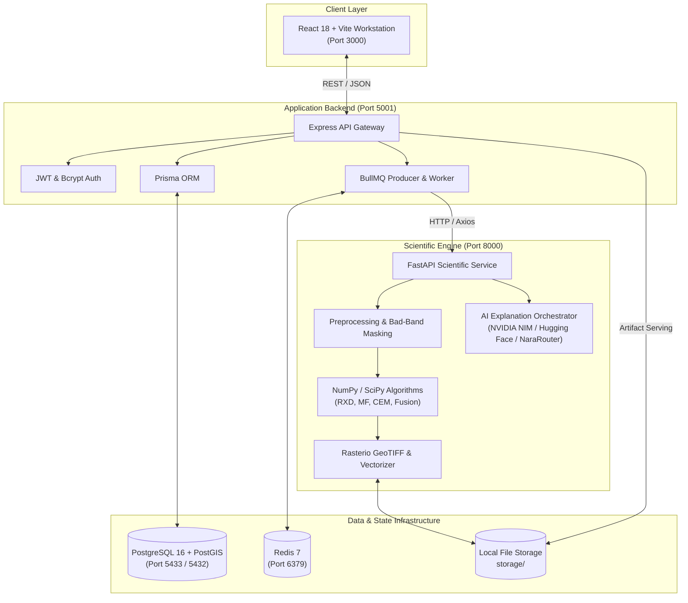

# GeoAstra — Hyperspectral Intelligence & Geospatial Detection Platform

[](LICENSE)
[](frontend/)
[](backend/)
[](ai-engine/)
[](docker-compose.yml)

**GeoAstra** is an end-to-end hyperspectral remote sensing platform that unites imaging spectroscopy with an asynchronous enterprise backend and a modern scientific workstation frontend. It processes multi-band hyperspectral cubes ($0.4\text{ to }2.5\,\mu\text{m}$) to detect diagnostic chemical, mineral, and vegetation signatures across airborne and spaceborne earth observation datasets.

---

## Table of Contents

- [Overview & Problem Statement](#overview--problem-statement)
- [Key Features](#key-features)
- [Scientific Algorithms](#scientific-algorithms)
- [System Architecture](#system-architecture)
- [Repository Structure](#repository-structure)
- [Quickstart Guide](#quickstart-guide)
  - [Prerequisites](#prerequisites)
  - [1. Infrastructure (PostgreSQL & Redis)](#1-infrastructure-postgresql--redis)
  - [2. Scientific Engine (`ai-engine`)](#2-scientific-engine-ai-engine)
  - [3. Application Backend (`backend`)](#3-application-backend-backend)
  - [4. Frontend Workstation (`frontend`)](#4-frontend-workstation-frontend)
- [API & Service Endpoints](#api--service-endpoints)
- [Testing & Quality Assurance](#testing--quality-assurance)
- [License](#license)

---

## Overview & Problem Statement

Hyperspectral sensors measure reflected solar radiation across hundreds of contiguous, narrow spectral bands. These measurements reveal diagnostic molecular absorption features that multispectral satellites (such as Sentinel-2 or Landsat) cannot resolve. 

However, hyperspectral workflows face distinct operational hurdles:
1. **High Dimensionality & Cube Scale:** Flightlines and scenes comprise millions of pixels across hundreds of bands ($H \times W \times B$).
2. **Computational Complexity:** Background modeling and covariance matrix inversion require numerically stable matrix regularizations.
3. **AI Hallucinations in Earth Observation:** Generic foundation models often invent chemical classifications without domain validation.

### Scientific Philosophy: Independent Authority
GeoAstra enforces **independent scientific authority**:
- **Deterministic Numerical Core:** Core target and anomaly detection is computed strictly via deterministic mathematical remote sensing algorithms (RXD, MF, CEM) in Python/NumPy/SciPy/Rasterio.
- **LLM as Explanation Layer:** Generative AI models (NVIDIA NIM, Hugging Face, NaraRouter) act strictly as an interpretation and synthesis layer — providing scientific explanations and comparative summaries without ever altering numerical scores or spatial detections.

---

## Key Features

- **Area of Interest (AOI) Management:** Create, inspect, update, and manage vector polygons (EPSG:4326 GeoJSON) designating geographic surveillance zones.
- **Hyperspectral Scene Catalog:** Ingestion, indexing, and spatial footprint discovery of spaceborne and airborne hyperspectral datasets (NASA AVIRIS, ROSIS, NASA EMIT, EnMAP).
- **Target Spectral Library:** Storage and provenance tracking of verified reference reflectance spectra (USGS Spectral Library v7, laboratory standards, and user-uploaded curves).
- **Automated Scientific Preprocessing:**
  - Automated NaN/Inf data sanitization and cube shape validation.
  - Variance-based bad-band identification and atmospheric water-vapor absorption masking ($1.35\text{--}1.42\,\mu\text{m}$, $1.80\text{--}1.95\,\mu\text{m}$).
  - $L_2$, standard (z-score), and min-max normalization.
  - Principal Component Analysis (PCA) dimensionality reduction.
- **Geospatial Product Export:**
  - Continuous 32-bit floating-point georeferenced GeoTIFFs.
  - Vectorized detection contours exported as GeoJSON FeatureCollections.
  - 8-bit RGBA PNG heatmap previews rendered with scientific colormaps.
- **Multi-Provider AI Orchestration:** Fault-isolated parallel dispatch of detection metrics to NVIDIA NIM, Hugging Face Inference, NaraRouter, and an offline deterministic physics-rule synthesizer.
- **Enterprise Asynchronous Queue:** Redis-backed BullMQ job queue with multi-stage lifecycle tracking (queued $\to$ data acquisition $\to$ preprocessing $\to$ algorithm execution $\to$ output generation $\to$ completed) and cancellation control.
- **Scientific Workstation UI:** Dark-first React/TypeScript interface featuring interactive map layers, spectral signature comparisons, and ROC evaluation charts.

---

## Scientific Algorithms

| Algorithm | Type | Description | Primary Use Case |
| :--- | :--- | :--- | :--- |
| **Reed-Xiaoli Detector (RXD)** | Unsupervised Anomaly | Evaluates Mahalanobis distance of each pixel vector $\mathbf{x}$ from global background mean $\boldsymbol{\mu}$ and covariance $\mathbf{\Sigma}$: $r_{\text{RXD}}(\mathbf{x}) = (\mathbf{x} - \boldsymbol{\mu})^T \mathbf{\Sigma}^{-1} (\mathbf{x} - \boldsymbol{\mu})$. | Detecting uncharacteristic objects, man-made anomalies, or surface disruptions without prior reference spectra. |
| **Matched Filter (MF)** | Supervised Target | Projects pixel vectors onto normalized background-whitened target spectrum $\mathbf{d}$: $r_{\text{MF}}(\mathbf{x}) = \frac{(\mathbf{d} - \boldsymbol{\mu})^T \mathbf{\Sigma}^{-1} (\mathbf{x} - \boldsymbol{\mu})}{(\mathbf{d} - \boldsymbol{\mu})^T \mathbf{\Sigma}^{-1} (\mathbf{d} - \boldsymbol{\mu})}$. | Pinpointing specific diagnostic materials (e.g., Kaolinite doublets, Alunite, Chlorophyll). |
| **Constrained Energy Minimization (CEM)** | Supervised Target | Constrains correlation output to unity for target vector $\mathbf{d}$ while minimizing total output energy: $\mathbf{w} = \frac{\mathbf{R}^{-1} \mathbf{d}}{\mathbf{d}^T \mathbf{R}^{-1} \mathbf{d}}$. | Sub-pixel target detection with dense background suppression using correlation matrix $\mathbf{R}$. |
| **Score Fusion** | Multi-Method Ensemble | Computes a normalized convex combination of target abundance and anomaly score surfaces: $S_{\text{fused}} = \alpha S_{\text{target}} + (1 - \alpha) S_{\text{anomaly}}$. | High-confidence spatial corroboration minimizing false alarm rates. |

---

## System Architecture



---

## Repository Structure

```
.
├── ai-engine/                  # Scientific Computing & Algorithm Engine
│   ├── app/
│   │   ├── algorithms/         # RXD, MF, CEM, Fusion implementations
│   │   ├── api/v1/             # FastAPI routers (analysis, health, etc.)
│   │   ├── core/               # Scientific config & raster utilities
│   │   ├── preprocessing/      # Bad band removal, normalization, PCA
│   │   ├── providers/          # AI Orchestrator (NVIDIA NIM, Hugging Face, etc.)
│   │   └── services/           # Pipeline coordination & artifact generation
│   ├── tests/                  # Pytest test suite
│   ├── requirements.txt        # Python dependencies
│   └── run.py                  # AI Engine startup script
├── backend/                    # Application Gateway & Job Queue
│   ├── prisma/                 # Database schema & migrations
│   ├── src/
│   │   ├── controllers/        # Route controllers
│   │   ├── middleware/         # Auth, validation, error handling
│   │   ├── routes/             # Express API routes
│   │   ├── services/           # Business logic & AI Engine integration
│   │   ├── workers/            # BullMQ background queue workers
│   │   └── server.js           # Server entry point
│   ├── tests/                  # Jest integration & unit tests
│   └── package.json            # Node.js dependencies & scripts
├── frontend/                   # Scientific Workstation UI
│   ├── src/
│   │   ├── api/                # Axios API clients
│   │   ├── components/         # Design system & shared UI components
│   │   ├── features/           # Feature domains (analysis, jobs, results, etc.)
│   │   └── styles/             # Global Tailwind tokens & themes
│   ├── vite.config.ts          # Vite build configuration
│   └── package.json            # Frontend dependencies & scripts
├── storage/                    # Local Raster Storage
│   ├── input/                  # Ingested scenes (AVIRIS, PaviaU, etc.)
│   ├── intermediate/           # Cleaned cubes & intermediate masks
│   ├── output/                 # Output GeoTIFF rasters & GeoJSON polygons
│   └── previews/               # 8-bit RGBA PNG heatmap previews
├── docker-compose.yml          # PostgreSQL (PostGIS) & Redis services
└── PROJECT_CONTEXT.md          # Comprehensive architecture & engineering guide
```

---

## Quickstart Guide

### Prerequisites
- **Node.js** `>= 20.0.0`
- **Python** `3.13` (with `venv`)
- **Docker & Docker Compose** (for PostgreSQL and Redis)

---

### 1. Infrastructure (PostgreSQL & Redis)

Start the local database and Redis broker using Docker:
```bash
docker compose up -d
```
- PostgreSQL with PostGIS runs on host port **`5433`** (mapped from container `5432`).
- Redis runs on host port **`6379`**.

---

### 2. Scientific Engine (`ai-engine`)

Create a virtual environment and start the FastAPI service:
```bash
cd ai-engine
python3 -m venv .venv
source .venv/bin/activate
pip install -r requirements.txt
uvicorn app.main:app --host 0.0.0.0 --port 8000 --reload
```
- Health Check: `http://localhost:8000/health`
- Interactive Swagger Docs: `http://localhost:8000/docs`

---

### 3. Application Backend (`backend`)

Install dependencies, run database migrations, and launch the Express server:
```bash
cd backend
npm install
npx prisma migrate dev
npm run dev
```
- Health Check: `http://localhost:5001/health`
- Service Diagnostics: `http://localhost:5001/api/v1/health/services`

---

### 4. Frontend Workstation (`frontend`)

Install dependencies and start the Vite development server:
```bash
cd frontend
npm install
npm run dev
```
- Web Application: `http://localhost:3000`

---

## API & Service Endpoints

### Application Backend (`http://localhost:5001`)

| Method | Endpoint | Description |
| :--- | :--- | :--- |
| `GET` | `/health` | Core backend health status |
| `GET` | `/api/v1/health/services` | Aggregate health of Database, Redis, and AI Engine |
| `POST` | `/api/v1/auth/register` | Register new user account |
| `POST` | `/api/v1/auth/login` | Authenticate and obtain JWT token |
| `GET` | `/api/v1/areas` | List user Areas of Interest (AOIs) |
| `POST` | `/api/v1/areas` | Create a new vector AOI (GeoJSON) |
| `GET` | `/api/v1/scenes` | List catalogued hyperspectral scenes |
| `GET` | `/api/v1/analyses` | List submitted analysis jobs |
| `POST` | `/api/v1/analyses` | Submit a new hyperspectral analysis job |
| `GET` | `/api/v1/analyses/:id` | Retrieve job lifecycle status and telemetry |
| `POST` | `/api/v1/analyses/:id/cancel` | Cancel an active processing job |
| `GET` | `/api/v1/analyses/:id/raster` | Download output 32-bit floating-point GeoTIFF |
| `GET` | `/api/v1/analyses/:id/polygons` | Download output detection vector GeoJSON |

### Scientific Engine (`http://localhost:8000`)

| Method | Endpoint | Description |
| :--- | :--- | :--- |
| `GET` | `/health` | Scientific engine readiness check |
| `POST` | `/api/v1/preprocess` | Execute bad-band removal, normalization, or PCA |
| `POST` | `/api/v1/analyze` | Execute scientific hyperspectral detection (RXD, MF, CEM) |
| `GET` | `/docs` | OpenAPI / Swagger interactive documentation |

---

## Testing & Quality Assurance

### Application Backend Tests
Run the Jest test suite covering controllers, authentication, and service integration:
```bash
cd backend && npm test
```

### Scientific Engine Tests
Run pytest covering mathematical detectors, matrix regularization, bad-band masking, and AI adapters:
```bash
cd ai-engine && ./.venv/bin/pytest tests/ -v
```

### Frontend Build Verification
Verify type safety and Vite production bundling:
```bash
cd frontend && npm run build
```

---

## License

This project is licensed under the [MIT License](LICENSE).
